[](https://github.com/Naveen-Negi721700)


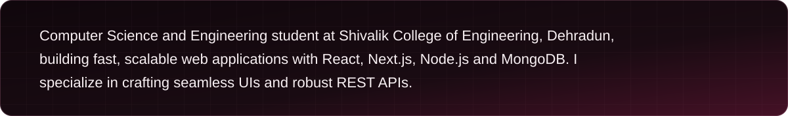


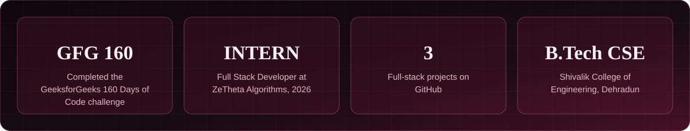


[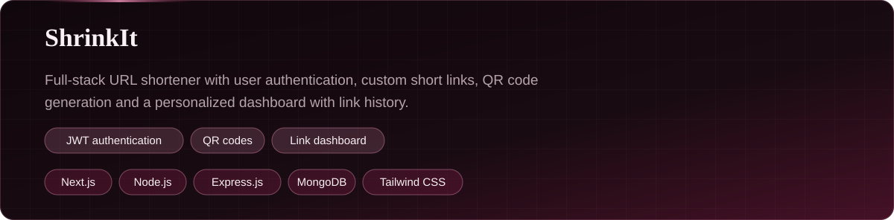](https://github.com/Naveen-Negi721700/URL_shorten)

[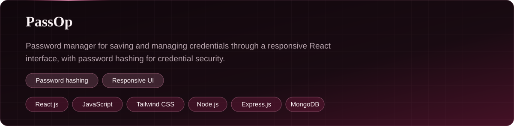](https://github.com/Naveen-Negi721700/Passop)

[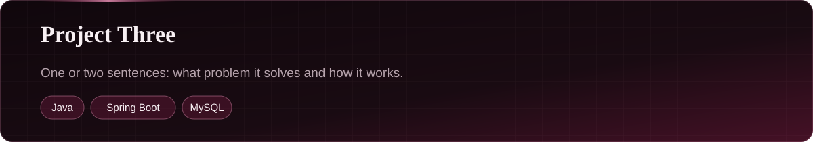](https://github.com/Naveen-Negi721700/Baas_project)


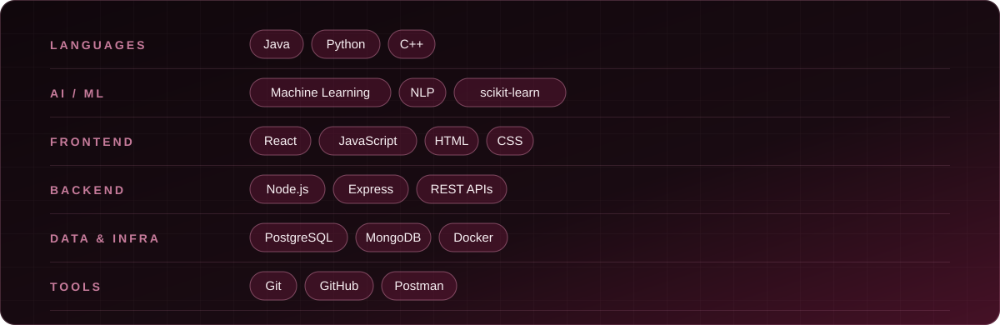



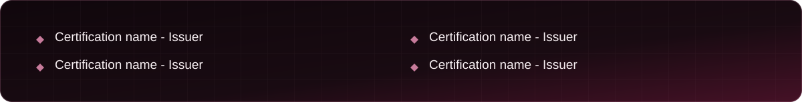


[](https://github.com/Naveen-Negi721700)
